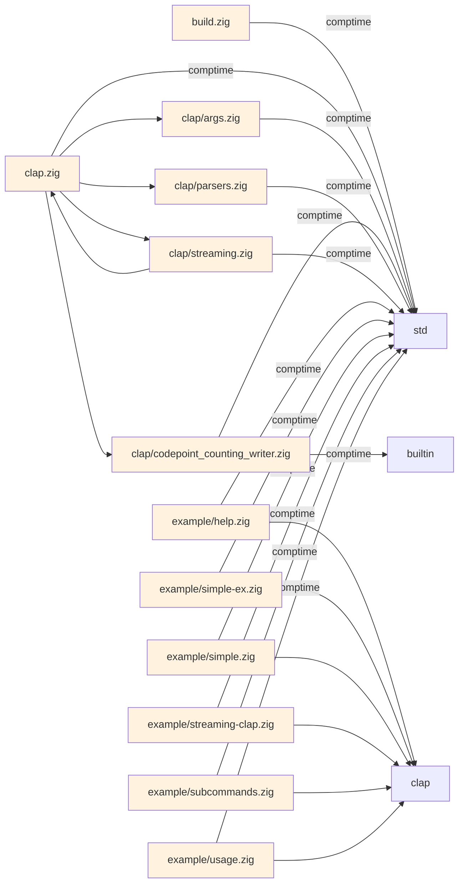

# repo2mmd

repo2mmd scans a repository and writes its dependency graph as a Mermaid
diagram and as JSON. The output is deterministic: the same input gives the
same Mermaid bytes, and the same JSON bytes when `SOURCE_DATE_EPOCH` is set. Every import edge in the JSON names the file and line that
created it, so you can check each relationship against the source.

repo2mmd is early alpha software. Zig import analysis works end to end. The
TypeScript plugin is experimental, and C files are skipped because there is no
C plugin yet. See [Limitations](#limitations).

## Example: zig-clap, from source to graph

This example runs repo2mmd on [Hejsil/zig-clap](https://github.com/Hejsil/zig-clap)
at commit
[`05faf39`](https://github.com/Hejsil/zig-clap/tree/05faf3905e8548f5cc269a8836e154065e70128d).
[`scripts/example.sh`](scripts/example.sh) produces every file in
[`examples/zig-clap/`](examples/zig-clap/), and CI fails if a rerun changes
any byte.

**Source.** Lines 2195 to 2200 of `clap.zig`:

```zig
pub const args = @import("clap/args.zig");
pub const parsers = @import("clap/parsers.zig");
pub const streaming = @import("clap/streaming.zig");
pub const ccw = @import("clap/codepoint_counting_writer.zig");

const std = @import("std");
```

**Evidence.** The five edges that leave `clap.zig` in
[`graph.json`](examples/zig-clap/graph.json), with the location each one cites:

| Edge (`src` → `dst`) | Certainty | Evidence |
| --- | --- | --- |
| `file_clap.zig` → `file_clap/args.zig` | Static | `clap.zig:2195` |
| `file_clap.zig` → `file_clap/parsers.zig` | Static | `clap.zig:2196` |
| `file_clap.zig` → `file_clap/streaming.zig` | Static | `clap.zig:2197` |
| `file_clap.zig` → `file_clap/codepoint_counting_writer.zig` | Static | `clap.zig:2198` |
| `file_clap.zig` → `file_std` | Comptime | `clap.zig:2200` |

One of those edges as it appears in the JSON:

```json
{
  "src": "file_clap.zig",
  "dst": "file_clap/args.zig",
  "rel": "Imports",
  "certainty": "Static",
  "evidence_paths": ["clap.zig"],
  "evidence_lines": [2195]
}
```

**Graph.** File-level view of the whole repository. These lines come
unchanged from [`graph.mmd`](examples/zig-clap/graph.mmd), with the
function and type nodes left out
([`files.mmd`](examples/zig-clap/files.mmd)). `std`, `builtin`, and `clap`
are modules rather than files: `std` and `builtin` come with the Zig
toolchain, and `build.zig` defines `clap` for the examples.



To reproduce the example, build repo2mmd and run the script. It needs `git`
and `jq`.

```bash
zig build
./scripts/example.sh
git diff --exit-code -- examples/
```

## Install

### From a release archive

Each [GitHub release](https://github.com/sammyjoyce/repo2mmd/releases) has
archives for `x86_64-linux-gnu`, `aarch64-linux-gnu`, `x86_64-macos`, and
`aarch64-macos`, plus a `SHA256SUMS` file. The Linux binaries need glibc 2.28
or newer.

```bash
sha256sum --check --ignore-missing SHA256SUMS
tar xzf repo2mmd-0.1.0-x86_64-linux-gnu.tar.gz
./repo2mmd-0.1.0-x86_64-linux-gnu/bin/repo2mmd --version
```

Keep `bin/` and `lib/` together. The binary loads its language plugins from
`../lib/repo2mmd/plugins` relative to itself. On macOS, if you downloaded the
archive with a browser, run `xattr -dr com.apple.quarantine` on the extracted
folder before you start the binary.

### From source

```bash
git clone --recurse-submodules https://github.com/sammyjoyce/repo2mmd.git
cd repo2mmd
zig build -Doptimize=ReleaseSafe
./zig-out/bin/repo2mmd --version
```

`zig build` compiles the CLI and the Zig and TypeScript plugins, including
the Tree-sitter C sources. You do not need a system C compiler.

## Toolchain

repo2mmd builds with **Zig 0.15.1** and no other version. Zig changes its
standard library and build API between minor releases, so the pin is exact:

- `build.zig.zon` sets `minimum_zig_version = "0.15.1"`. This is the single
  source of truth.
- `build.zig` stops with an error if the running Zig is any other version.
- `.mise.toml` pins the same version for [mise](https://mise.jdx.dev/) users.
- CI installs Zig with `mlugg/setup-zig`, which reads `build.zig.zon`.

To install Zig 0.15.1, download it from
[ziglang.org/download](https://ziglang.org/download/#release-0.15.1) or run
`mise install` in the repository. The Tree-sitter runtime and grammars are Git
submodules under `third_party/`, pinned to specific commits.

## Usage

```bash
repo2mmd [OPTIONS] PATH            # Mermaid for PATH on stdout
repo2mmd PATH -o graph.mmd         # write Mermaid to a file
repo2mmd PATH -o graph.json        # JSON, chosen by the file extension
repo2mmd PATH --format json        # JSON on stdout
repo2mmd --cache-mode off PATH     # skip the analysis cache
```

Run `repo2mmd --help` for every command and option.

- **JSON.** Nodes are files, functions, and types. Edges have `src`, `dst`,
  `rel`, `certainty`, `evidence_paths`, and `evidence_lines`. Paths are
  relative to `PATH`. When one file imports the same target twice, the edge
  lists both locations. [`docs/ir-schema.md`](docs/ir-schema.md) describes
  the format.
- **Determinism.** Files are processed in sorted path order. Set
  `SOURCE_DATE_EPOCH` to fix `manifest.generated_at`. Without it,
  `generated_at` is the current time.
- **Cache.** Parse results are cached under `$XDG_CACHE_HOME/repo2mmd`. The
  cache key includes the file content and the plugin version.
- **Plugins.** repo2mmd looks for plugins in `--plugin-dir`, then in
  `REPO2MMD_PLUGIN_DIRS`, then next to the binary, then in
  `$XDG_DATA_HOME/repo2mmd/plugins`.
- **Skipped paths.** Hidden directories (such as `.git` and `.zig-cache`),
  `zig-out`, `zig-cache`, and `node_modules` are not scanned. A file that a
  plugin cannot parse is reported as a warning and as an
  `R2M-SKIPPED-FILE` diagnostic, and the run continues.

## Limitations

- **Zig.** Import edges are file-level. Function and type nodes have no edges
  yet, so the full Mermaid graph shows them unconnected. A module import such
  as `@import("clap")` points at the module name, not at the file that
  `build.zig` maps it to.
- **TypeScript.** Experimental. It finds files, declarations, and some calls,
  but its edges do not carry evidence yet, and import resolution is
  incomplete.
- **C.** No plugin. `.c` and `.h` files are skipped.
- **Commands.** `generate` (also the default command) is the working path.
  `analyze` and `explain` are not implemented yet.
- **Schema.** Edges do not yet emit the `certainty_reason` and `diagnostics`
  fields that `docs/ir-schema.json` lists.

## Development

```bash
zig build                 # CLI and plugins into zig-out/
zig build test            # CLI smoke tests, discovery, scheduler, evidence
zig build plugins test-plugin-loader test-fixtures
zig build fmt-check
```

`zig build test` runs the CLI against a temporary repository and checks the
exact file and line of each import edge. Several older spec files under
`test/` do not compile against the current API and are not part of the
suite yet.

See [`CONTRIBUTING.md`](CONTRIBUTING.md) for the workflow and
[`docs/ARCHITECTURE.md`](docs/ARCHITECTURE.md) for the design.

## Releases

Pushing a `vX.Y.Z` tag that matches `.version` in `build.zig.zon` runs
[`.github/workflows/release.yml`](.github/workflows/release.yml). It builds
every archive on one Linux runner with
[`scripts/release.sh`](scripts/release.sh), runs the macOS arm64 archive on a
macOS runner, and opens a draft release for review. Nothing is committed to
the repository as a binary.

The archives are reproducible. For a given commit, `scripts/release.sh`
produces byte-identical archives in any checkout directory. Stripped
binaries, a fixed glibc target, and tar and gzip metadata from the commit
time make that possible. To check a published release, run the script at the
tagged commit and compare `dist/SHA256SUMS` with the release's file.

## License

repo2mmd is released under the MIT License. See [`LICENSE`](LICENSE).
Release archives also include the MIT licenses of Tree-sitter,
tree-sitter-typescript, and tree-sitter-zig under `licenses/`.
