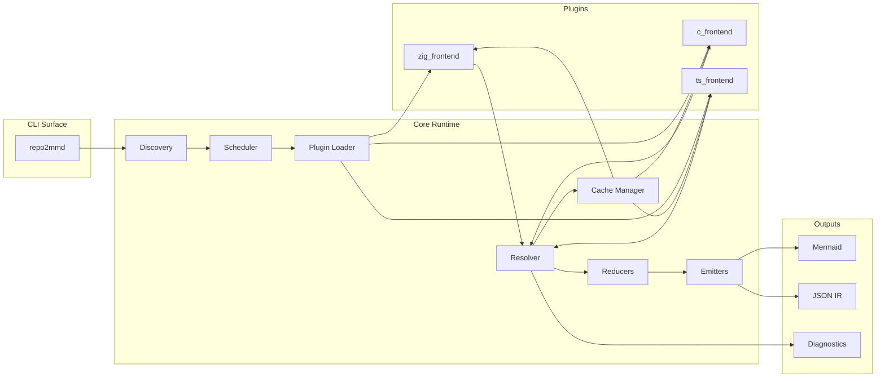
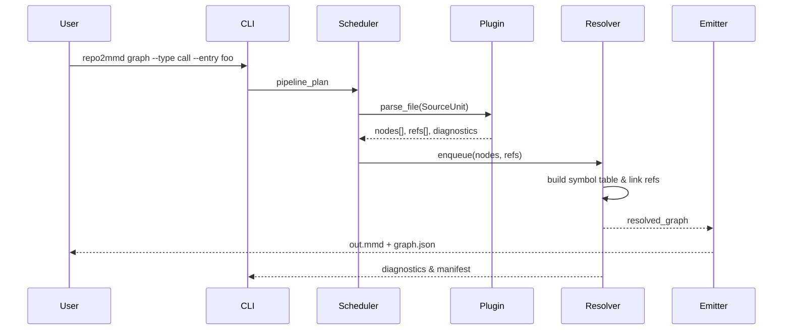

# repo2mmd Architecture Overview

_Last updated: 2025-10-06_

repo2mmd is a multi-language static analysis pipeline that turns repositories into deterministic graphs and Mermaid diagrams. This document explains how the core runtime, plugin ecosystem, and supporting infrastructure fit together so contributors can reason about changes end to end.

## 1. System Overview

## 2. Runtime Pipeline

1. **CLI Parsing.** `repo2mmd graph|explain|cache|init` parses flags, resolves config precedence, and constructs a `pipeline_plan` object describing requested graph types, scope, and output formats.
2. **Discovery.** The discovery module walks the repository root using `.gitignore`, optional `repo2mmd.toml` ignore globs, and language-specific heuristics to partition files into `SourceUnit` records (`path`, `lang`, `module_id`). Workspace markers (`build.zig`, `compile_commands.json`, `package.json`) define module boundaries.
3. **Scheduling.** A work-stealing pool (default `min(physical_cores, --threads)`) consumes `SourceUnit`s, batching small files and splitting oversized units when plugins support ranged parsing. Schedulers cooperate with the cache manager to skip unchanged files.
4. **Plugin Execution.** The loader dlopens each plugin matching the requested languages, negotiates ABI and schema versions, and dispatches `parse_file` calls with monotonic arenas supplied by the core. Plugins stream back node and reference slices plus diagnostics.
5. **Resolution.** The resolver builds sharded symbol tables from plugin outputs, resolves references to concrete node IDs, tags unresolved edges with reasons, and deduplicates nodes across languages.
6. **Reduction.** Reducers apply grouping (`package`, `dir`, `module`, `type`), pruning expressions (`degree`, `depth`), and entry-point slicing before emission. This phase also prepares summary statistics for the manifest.
7. **Emission.** Emitters transform the normalised graph into Mermaid diagrams (flowchart/class variants) and deterministic JSON IR. When requested, the emitter triggers the optional Mermaid CLI bridge to render SVG/PNG assets.
8. **Diagnostics & Exit Codes.** The pipeline aggregates diagnostics (`UNRESOLVED_REF`, `PARSE_ERROR`, `PLUGIN_ERROR`) and enforces CLI thresholds (`--max-unresolved`). Exit codes follow the contract: `0` success, `1` soft-failure due to unresolved refs over threshold, `2` fatal parse or plugin errors.

## 3. Core Components

### 3.1 Discovery
- Implements a layered ignore system: repository `.gitignore`, global git excludes, `repo2mmd.toml::ignore`, and CLI `--scope` pruning.
- Detects language roots by inspecting filenames, extension allowlists provided by plugins, and workspace manifests.
- Emits `SourceUnit` metadata consumed downstream and records module lineage for grouping.

### 3.2 Scheduler & Concurrency
- Uses lock-free deques per worker to enable work stealing.
- Supports cooperative cancellation (e.g., fatal plugin error triggers teardown).
- Applies memory back-pressure: when arena usage approaches `--max-bytes` the scheduler pauses new tasks until reducers flush completed work.

### 3.3 Plugin Loader
- Located at `src/plugins/loader.c`; centralises `dlopen`/`dlsym`, ABI validation, and capability negotiation.
- Maintains a registry of active plugins (`id`, `version`, supported `schema_range`, `capabilities`).
- Ensures every plugin invocation receives a zeroed, per-file arena that the core owns.

### 3.4 Resolver & Reducers
- Resolver is responsible for stable ID generation (xxHash64 of `fqname|kind|file|range`) and cross-language deduplication.
- Reducers provide slicing primitives used by CLI flags: `--scope`, `--group-by`, `--prune`, and `--entry` all map to reducer passes.
- Both modules emit metrics captured in `graph_manifest` (node/edge counts, unresolved references, cache hits/misses).

### 3.5 Emitters
- `emitter_mmd.c` renders flowcharts for dependency/call/include graphs and class diagrams for type relationships. Large graphs are chunked into sub-diagrams with an index markdown.
- `emitter_json.c` serialises the entire IR plus manifest in deterministic order, enabling CI diffing and downstream consumption.
- `emitter_dot.c` (optional) provides a debugging view for developers, not part of the public CLI default.

## 4. Language Plugin Architecture

### 4.1 ABI Contract
- Defined in `include/frontend.h`. Each plugin exports `const repo2mmd_frontend_v1 *repo2mmd_lang_frontend_v1(void)`.
- The `repo2mmd_frontend_v1` struct includes identifiers, API version, supported IR schema range, and function pointers (`wants_file`, `parse_file`, optional `post_resolve`, `shutdown`).
- Plugins must treat input as read-only, allocate outputs from the provided arena, and avoid retaining host pointers between invocations.

### 4.2 Bundled Plugins
- **TypeScript (`plugins/ts/ts_frontend.c`).** Uses Tree-sitter TypeScript/TSX grammars, resolves imports via `tsconfig.json`, emits functions, classes, interfaces, and call edges with certainty labels (`STATIC`, `DYNAMIC`).
- **Zig (`plugins/zig/zig_frontend.c`).** Tree-sitter Zig parsers extract container types, functions, `@import`, and `usingnamespace` relationships. Comptimes are flagged `COMPTIME` with evidence ranges.
- **C (`plugins/c/c_frontend.c`).** Prefers libclang when `compile_commands.json` is available; falls back to Tree-sitter-C for header-only projects. Handles include graphs, typedefs, function pointers (`INDIRECT`).

### 4.3 Plugin Lifecycle
1. Loader resolves plugin handle and ABI struct.
2. Core verifies schema compatibility (`schema_min <= current_schema <= schema_max`).
3. Scheduler dispatches `parse_file` tasks with per-file arenas.
4. After pipeline completion the core calls `shutdown()` for cleanup before unloading.

See `docs/plugins/overview.md` for authoring guidance and harness usage.

## 5. Data Flow & Evidence

Every edge includes a certainty tag plus optional evidence (file path + line numbers). `repo2mmd explain` surfaces these details directly from the IR.

## 6. Caching Strategy
- Cache directory: `.repo2mmd/cache/`. Each entry is a flat binary blob with header `{magic, version, schema_version, plugin_id, plugin_version, file_hash, created_at, checksum}` followed by serialized nodes, edges, and diagnostics.
- Cache lookup order: content hash + plugin version + schema version. Mismatches drop to cold parse.
- CLI exposes `repo2mmd cache prune|stats` to manage and inspect cache effectiveness.
- Cache metrics (hit, miss, invalidated) are embedded in `graph_manifest` for CI reporting.

## 7. Build & Packaging
- Zig orchestrates both the core binary and shared plugins. `build.zig` defines custom steps:
  - `graph` (default executable build)
  - `test` (unit, golden, integration harness)
  - `perf` (benchmark suite)
  - `fuzz` (Tree-sitter/libclang fuzz harness)
- Build pipeline stages plugin outputs into `zig-out/lib/repo2mmd/plugins/` alongside exported headers for third-party authors.
- Release artifacts bundle the binary, plugins, headers, sample configs, and documentation.

## 8. Operations & Observability
- **Diagnostics.** JSON diagnostics file lists unresolved refs, parse errors, and plugin failures with severity. CLI flags (`--max-unresolved`, `--ci`) enforce thresholds.
- **Logging.** Structured logs (JSON lines) available at `--log-level debug`, capturing plugin latencies, cache decisions, and reducer actions.
- **Performance Budgets.** Automated benchmarks enforce `< 90 s` cold on reference 1M LOC repo and `< 5 s` warm on 100-file change scenario (8-core, 16 GB machine). Results are recorded per commit.
- **Resource Controls.** `--threads` limits worker count; `--max-bytes` caps arena memory; `--no-cache` forces cold runs for debugging.

## 9. Security & Safety
- No user code execution by default. Optional trace mode (post-v0.1 roadmap) must be explicitly enabled.
- Plugin loading restricted to known directories; future roadmap includes signed plugin manifests.
- Path handling guards against traversal attacks (`--link-src` templates validated against canonicalised paths).
- All external grammar/vendor dependencies are pinned and hashed; cache keys include those hashes to prevent stale replays.

## 10. Related Documents
- [PLAN.md](../PLAN.md) — Product & engineering plan with roadmap and acceptance metrics.
- [docs/ir-schema.md](./ir-schema.md) — JSON schema reference for the IR and manifest.
- [docs/plugins/overview.md](./plugins/overview.md) — Authoring guide for language plugins.
- [docs/config.md](./config.md) — Configuration precedence, file format, and flag reference.
- [docs/README.md](./README.md) — Contributor quick-start and project index.

